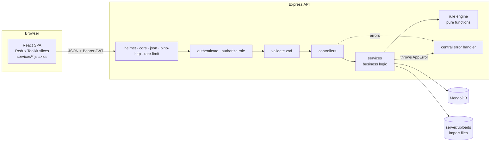
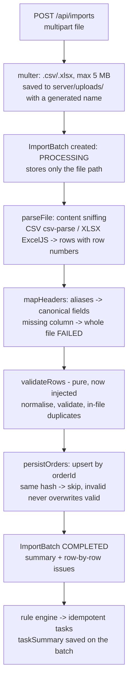
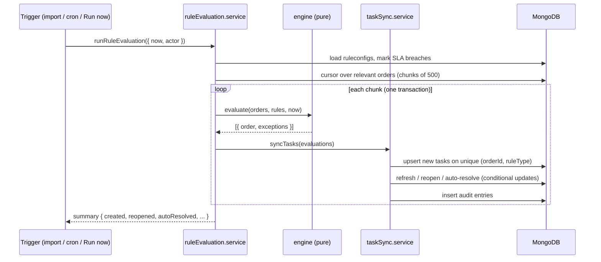

# Architecture

## 1. System overview

A classic three-tier web application: a React single-page app talks JSON over HTTP to an Express
REST API, which stores everything in MongoDB. Uploaded files live on the server's disk; the DB keeps
only their path.



## 2. Request lifecycle

1. **helmet** sets security headers; **cors** allows only the configured UI origin (with credentials
   so the refresh-token cookie travels).
2. **express.json** parses the body (1 MB limit; malformed JSON → 400).
3. **pino-http** assigns a request id (`X-Request-Id` header) and logs one line per request.
4. **rate limiter** caps requests per IP.
5. Route-level middleware: `authenticate` (JWT) → `authorize(role)` (RBAC) → `validate(zod)`.
6. **Controller** reads the validated input, calls a **service**, sends `{ data }` /
   `{ data, pagination }`.
7. Any thrown error (Express 5 forwards rejected promises automatically) reaches the **error
   handler**, which converts it into `{ error: { code, message, details, requestId } }`.

## 3. Layers and their responsibilities

| Layer       | Folder                      | Knows about HTTP? | Responsibility                                     |
| ----------- | --------------------------- | ----------------- | -------------------------------------------------- |
| Routes      | `modules/*/x.routes.js`     | yes               | URL + method → middleware chain → controller       |
| Controllers | `modules/*/x.controller.js` | yes               | Translate HTTP ⇄ service calls; no business rules  |
| Services    | `modules/*/x.service.js`    | **no**            | Business logic, transactions, audit writes         |
| Models      | `models/`                   | no                | Mongoose schemas, indexes, data-level invariants   |
| Rule engine | `rule-engine/`              | no, and no DB     | Pure `evaluate(orders, configs, now)` → exceptions |

Services throw `AppError` subclasses (`NotFoundError`, `ForbiddenError`, …) instead of writing
responses, so the same service can be called from an HTTP controller, a cron job or a script.

## 4. Folder structure

```
server/
├─ src/
│  ├─ app.js            builds the Express app (no listen → testable with supertest)
│  ├─ server.js         entry point: upload dir, DB connect, listen, graceful shutdown
│  ├─ routes.js         mounts every module under /api
│  ├─ config/           env.js (zod-validated env), db.js (connect + withTransaction),
│  │                    logger.js (pino), paths.js (upload folder)
│  ├─ constants/        roles, order statuses + synonyms, import issue codes
│  ├─ errors/           AppError hierarchy
│  ├─ import/           columns (header aliases), normalizers, parsers (CSV/XLSX),
│  │                    rowValidator (pure)
│  ├─ middleware/       auth (authenticate/authorize), validate, upload, rateLimiter,
│  │                    notFound, errorHandler
│  ├─ jobs/             ruleEvaluation.job.js (node-cron, every 15 min)
│  ├─ models/           User, RefreshToken, Order, ImportBatch, RuleConfig, Task,
│  │                    AuditLog (+ plugins/toJSON)
│  ├─ modules/          health, auth, users, imports, orders, rules, tasks (sync),
│  │                    audit (dashboard, reports added in later parts)
│  ├─ rule-engine/      BaseRule, rules/*.rule.js, registry, engine (pure), format
│  └─ utils/            dates (IST), pagination, tokens, validation
├─ scripts/             initReplicaSet.js, seedUsers.js (+ full seed, sample generator later)
├─ tests/               unit/ and integration/
└─ uploads/             uploaded files (git-ignored)

client/
├─ index.html · vite.config.js (dev proxy /api → :5000)
└─ src/
   ├─ main.jsx · App.jsx · index.css (Tailwind + brand theme)
   └─ services/         api.js (single axios instance) + one service per domain
   (store/, features/, components/, pages/, routes/, hooks/, utils/ added in Part 7)
```

## 5. Transactions strategy

`config/db.js` checks at startup whether MongoDB is a replica set (`hello.setName`).
`withTransaction(work)` then either runs `work(session)` inside a real transaction (all writes
commit or none) or – on a standalone server – runs `work(null)`, where each write is still atomic
for its own document. Callers always pass `{ session }` to Mongoose, which accepts `null`.

## 6. Import pipeline (Part 3)



Orders and the batch summary are written in one `withTransaction` block; the rule engine then
runs over all relevant orders (not just this file's), so time-based rules stay current.

## 7. Rule engine and task sync (Part 4)



Details, the idempotency table and how to change or add a rule: [RULE_ENGINE.md](RULE_ENGINE.md).

## 8. Planned components (later parts)

- **Task APIs + audit APIs:** list/filter tasks, status changes, reassignment (transaction with
  audit), audit trail queries (Part 5).
- **Dashboard + daily CSV report** with server-side filters and streamed CSV (Part 6).
