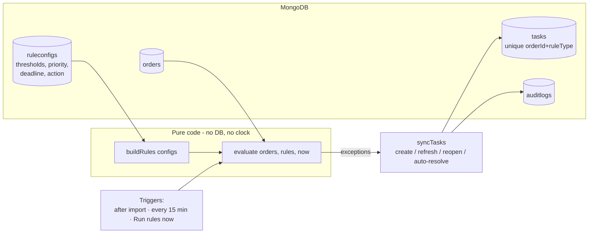

# Rule Engine

The rule engine looks at every relevant order and decides which **exceptions** it raises right
now. Each exception becomes a **task** with a reason, priority, recommended action and deadline.

## 1. Design in one picture



- **Pure core** (`server/src/rule-engine/`): `engine.evaluate(orders, rules, now)` never reads the
  clock or the database. Same input → same output, so every rule is unit-tested with a fixed `now`.
- **Config in the database** (`ruleconfigs`): thresholds, priority, task deadline, recommended
  action and on/off switch. Editable by a manager via `PATCH /api/rules/:ruleType`.
- **Task sync** (`modules/tasks/taskSync.service.js`): applies the verdict idempotently.

## 2. The rules

| Rule (`ruleType`)   | Fires when (defaults)                                                                      | Priority | Task deadline | Recommended action                                                   |
| ------------------- | ------------------------------------------------------------------------------------------ | -------- | ------------- | -------------------------------------------------------------------- |
| `UNCONFIRMED_ORDER` | status UNCONFIRMED and `now − orderDate` **> 2 h** (`thresholdHours`)                      | Medium   | 4 h           | Call the customer to confirm; for COD confirm address and acceptance |
| `DISPATCH_DELAY`    | status CONFIRMED, no dispatch date, `now − orderDate` **> 24 h** (`thresholdHours`)        | Medium   | 8 h           | Escalate to warehouse; inform customer of new dispatch date          |
| `SHIPMENT_DELAY`    | status DISPATCHED and `now >` expected delivery (+ `graceHours`, default 0)                | Medium   | 24 h          | Chase courier, send customer an updated ETA                          |
| `FAILED_DELIVERY`   | status DELIVERY_FAILED                                                                     | **High** | 4 h           | Call customer today, request re-attempt, avoid RTO                   |
| `HIGH_VALUE_DELAY`  | value **> ₹5,000** (`amountThreshold`), not delivered/cancelled, `now >` expected delivery | **High** | 4 h           | Urgent courier escalation + proactive customer call                  |
| `DATA_CORRECTION`\* | order has `dataStatus = NEEDS_CORRECTION`                                                  | Low      | 24 h          | Fix the listed fields in the source sheet and re-upload              |

\* Not one of the PDF's five rules – an agreed addition so orders with bad data are not forgotten.

Notes:

- **"More than" is strict.** Exactly 2 h unconfirmed or exactly ₹5,000 does not fire.
- **Dispatch delay is measured from the order date** – the file has no "confirmed at" timestamp.
- **Expected delivery date without a time** = end of that IST day, so a parcel due "20-10-2026"
  becomes late from 21-10-2026 00:00.
- **One order can raise several exceptions** – a ₹7,499 parcel past its expected date raises both
  `SHIPMENT_DELAY` and `HIGH_VALUE_DELAY`. One task per rule keeps category counts accurate.
- **Required information:** business rules only look at `VALID` orders. If data needed by a rule
  is missing (e.g. a dispatched order without expected delivery date), the importer already marked
  the order `NEEDS_CORRECTION`, so it gets a `DATA_CORRECTION` task instead of a business flag. A
  rule whose input is legitimately absent (no expected delivery date on a confirmed order) simply
  does not fire.
- **Deadline** = time of detection + the rule's `deadlineHours`. **Overdue** = unresolved and past
  the deadline (computed at query time). `slaBreached` is set permanently once a deadline is missed.

## 3. When the engine runs

| Trigger            | Where                                     | `now`                  | Recorded as (audit)     |
| ------------------ | ----------------------------------------- | ---------------------- | ----------------------- |
| After every import | `import.service.js → evaluateAfterImport` | upload time, or `asOf` | the uploading manager   |
| Every 15 minutes   | `jobs/ruleEvaluation.job.js` (node-cron)  | real time              | System                  |
| "Run rules now"    | `POST /api/rules/evaluate`                | real time, or `asOf`   | the manager who clicked |

The scheduler exists because several rules depend on **time passing**, not on new data: an order
1 h unconfirmed at upload is "more than 2 h unconfirmed" an hour later without any new file.

Only orders that can still raise an exception are scanned (unconfirmed, confirmed, dispatched,
failed, needs-correction) plus any order that still has an open task. Orders are processed in
chunks of 500, each chunk in its own transaction (when MongoDB runs as a replica set). Runs inside
one process are serialised, so an import and a scheduled run never interleave.

## 4. Idempotency – what happens on every evaluation

Key: **one task per `(orderId, ruleType)`**, enforced by a **unique compound index** on `tasks`.

| Rule result for the order | Existing task      | Order data changed since last sync? | Action                                                      | Audit                        |
| ------------------------- | ------------------ | ----------------------------------- | ----------------------------------------------------------- | ---------------------------- |
| fires                     | none               | –                                   | **create** (upsert on the unique key)                       | TASK_CREATED + TASK_ASSIGNED |
| fires                     | Open / In Progress | no                                  | keep; update `lastDetectedAt`                               | –                            |
| fires                     | Open / In Progress | yes                                 | keep status/owner/deadline; refresh reason & order snapshot | –                            |
| fires                     | Resolved           | no                                  | **stay resolved** (same file re-uploaded)                   | –                            |
| fires                     | Resolved           | yes                                 | **reopen** with new deadline, `reopenCount + 1`             | REOPENED                     |
| does not fire             | Open / In Progress | yes                                 | **auto-resolve** (e.g. now delivered)                       | AUTO_RESOLVED                |
| does not fire             | Open / In Progress | no                                  | leave open (rule was loosened/disabled – a human decides)   | –                            |

"Order data changed" is detected with `sourceHash` – a hash of the normalised order content
stored on both the order and the task.

Why uploading the same file twice creates **zero** tasks:

1. Orders: same content → same hash → no write.
2. Tasks: the rule fires again for the same `(orderId, ruleType)` → the task already exists → no
   create. Even if two evaluations race, the **unique index** means the database itself refuses a
   second task, and state transitions use conditional updates (`status` + `sourceHash` in the
   filter) so only one of them can win and write an audit entry.

## 5. Changing a rule (live challenge: dispatch 24 h → 12 h)

**Through the API / UI (no code change, no restart):**

```bash
curl -X PATCH http://localhost:5000/api/rules/DISPATCH_DELAY \
  -H "Authorization: Bearer $TOKEN" -H "Content-Type: application/json" \
  -d '{"params": {"thresholdHours": 12}}'

curl -X POST http://localhost:5000/api/rules/evaluate -H "Authorization: Bearer $TOKEN"
```

The change is validated by the rule's own schema (unknown keys or negative numbers → 400) and
written to the audit log with old → new values. It applies on the next evaluation (import,
scheduler, or the "Run rules now" call above). Existing open tasks are not closed by loosening
a rule.

**Changing the default in code** (used only when a fresh database is first seeded):
`server/src/rule-engine/rules/dispatchDelay.rule.js` → `defaults.params.thresholdHours: 24`.
After the first start the database is the source of truth; `ensureRuleConfigs()` never
overwrites stored values.

Other examples:

```jsonc
PATCH /api/rules/HIGH_VALUE_DELAY  { "params": { "amountThreshold": 10000 } }
PATCH /api/rules/FAILED_DELIVERY   { "priority": "HIGH", "deadlineHours": 2 }
PATCH /api/rules/SHIPMENT_DELAY    { "params": { "graceHours": 12 } }
PATCH /api/rules/UNCONFIRMED_ORDER { "enabled": false }
```

## 6. Adding a new rule

Example: flag COD orders above ₹20,000 that are still unconfirmed after 30 minutes.

1. Add the type to `server/src/constants/rules.js`:
   ```js
   HIGH_VALUE_COD_UNCONFIRMED: 'HIGH_VALUE_COD_UNCONFIRMED',
   ```
2. Create `server/src/rule-engine/rules/highValueCodUnconfirmed.rule.js`:
   ```js
   import { z } from 'zod';
   import { BaseRule } from '../BaseRule.js';
   import { ORDER_STATUS, PAYMENT_TYPE } from '../../constants/order.js';
   import { PRIORITY, RULE_TYPE } from '../../constants/rules.js';
   import { hoursBetween } from '../../utils/dates.js';

   export class HighValueCodUnconfirmedRule extends BaseRule {
     static type = RULE_TYPE.HIGH_VALUE_COD_UNCONFIRMED;
     static label = 'High-value COD unconfirmed';
     static description = 'Large COD order not confirmed quickly.';
     static paramsSchema = z.object({
       amountThreshold: z.number().positive(),
       thresholdHours: z.number().positive(),
     });
     static paramFields = [
       { key: 'amountThreshold', label: 'COD value above', unit: '₹' },
       { key: 'thresholdHours', label: 'Unconfirmed for more than', unit: 'hours' },
     ];
     static defaults = {
       enabled: true,
       params: { amountThreshold: 20000, thresholdHours: 0.5 },
       priority: PRIORITY.HIGH,
       deadlineHours: 1,
       action: 'Call the customer immediately to verify the COD order.',
     };

     matches(order, now) {
       return (
         order.paymentType === PAYMENT_TYPE.COD &&
         order.status === ORDER_STATUS.UNCONFIRMED &&
         order.orderValue > this.params.amountThreshold &&
         hoursBetween(order.orderDate, now) > this.params.thresholdHours
       );
     }

     reason(order) {
       return `COD order of ₹${order.orderValue} still unconfirmed`;
     }
   }
   ```
3. Register it in `server/src/rule-engine/registry.js` (`RULE_CLASSES`).
4. Add unit tests in `server/tests/unit/ruleEngine.test.js`.

On the next start, its default config is inserted into `ruleconfigs`, it appears in
`GET /api/rules` (and the Rule Settings page), and the engine evaluates it – no other change needed.

## 7. Files

| File                                      | Responsibility                                              |
| ----------------------------------------- | ----------------------------------------------------------- |
| `rule-engine/BaseRule.js`                 | rule contract; VALID-data guard; `buildException`           |
| `rule-engine/rules/*.rule.js`             | one class per rule                                          |
| `rule-engine/registry.js`                 | list of all rules                                           |
| `rule-engine/engine.js`                   | `buildRules`, `evaluateOrder`, `evaluate` (pure)            |
| `rule-engine/format.js`                   | durations ("5h 12m") and rupees ("₹7,499") in reasons       |
| `modules/rules/ruleConfig.service.js`     | seed defaults, list, validate + update configs (audited)    |
| `modules/rules/ruleEvaluation.service.js` | load configs, scan orders in chunks, call engine + sync     |
| `modules/tasks/taskSync.service.js`       | idempotent create / refresh / reopen / auto-resolve + audit |
| `jobs/ruleEvaluation.job.js`              | 15-minute scheduler                                         |
| `tests/unit/ruleEngine.test.js`           | every rule, boundaries, config changes, determinism         |
| `tests/integration/rules.test.js`         | import → tasks, re-upload, 24→12 h, time passing, lifecycle |
